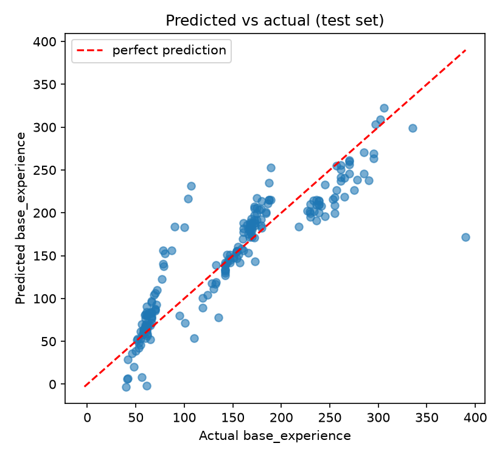
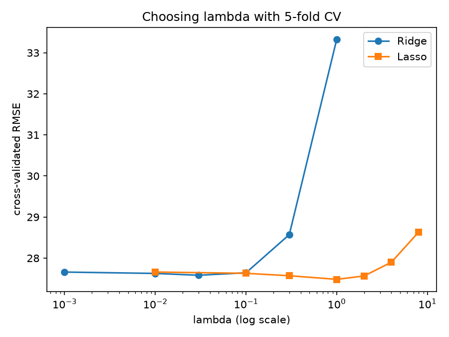
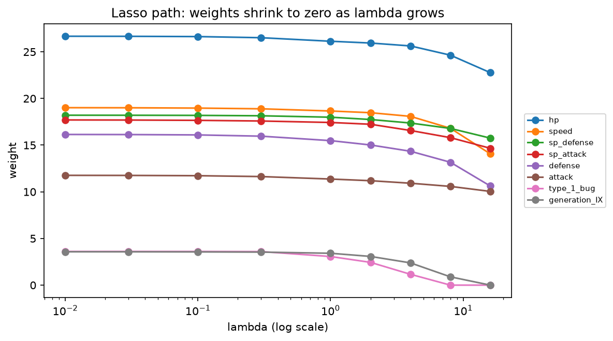

# Regression From Scratch: Predicting Pokémon Base Experience

Linear, Ridge and Lasso regression implemented from scratch with NumPy
(gradient descent, no scikit-learn models), applied to a real Pokémon dataset
to predict `base_experience`, the XP a Pokémon gives when defeated.

## What this project covers

- Linear regression trained with **gradient descent**, built from first principles
- **Ridge (L2)** and **Lasso (L1)** regularization, including soft-thresholding for exact zeros
- **Feature scaling**, a **train/test split**, and **k-fold cross-validation**, all written from scratch
- Metrics: RMSE, MAE and R², compared against a "predict the average" baseline
- Honest evaluation: the test set is touched only once, after λ is chosen by cross-validation

## Dataset

Source: [Ultimate Pokémon Dataset 2026]
(https://www.kaggle.com/datasets/darkmatternet/ultimate-pokmon-dataset-2025) by DarkMatterNet on Kaggle (CC0: Public Domain), originally scraped from [PokéAPI](https://pokeapi.co).

1,025 Pokémon with battle stats, size, capture rate and categories.
Target: `base_experience`. Features: 10 numeric columns (hp, attack, defense,
sp_attack, sp_defense, speed, height, weight, capture_rate, base_happiness),
plus one-hot encoded `type_1` and `generation` (37 features in total).
Columns derived from other columns (such as `base_stat_total` and `bmi`) were removed to avoid redundancy.

## Results (held-out test set, 20% of data)

| Model | Features | RMSE | MAE | R² |
|---|---|---|---|---|
| Baseline (predict training mean) | - | 77.19 | 63.74 | -0.001 |
| Linear | 10 numeric | 32.92 | 22.47 | 0.818 |
| Ridge (λ=0.1) | 10 numeric | 32.99 | 22.41 | 0.817 |
| Lasso (λ=0.1) | 10 numeric | 32.92 | 22.47 | 0.818 |
| Linear | 37 | 33.32 | 22.79 | 0.813 |
| Ridge (λ=0.03, chosen by CV) | 37 | 33.23 | 22.71 | 0.814 |
| Lasso (λ=1.0, chosen by CV) | 37 | 32.97 | 22.56 | 0.817 |





## Key findings

- The models cut the baseline error by more than half (RMSE 77 → about 33) and explain about 82% of the variance in XP.
- **Ridge and Lasso did not meaningfully beat plain linear regression.** Differences of about 0.3 RMSE are far smaller than the fold-to-fold variation in cross-validation (about ±4.6), so the models are effectively tied. With only 10 to 37 features and about 800 training rows, there is little overfitting to correct.
- **Type and generation added nothing.** Adding them left the test error unchanged, so the six battle stats carry nearly all the signal.
- Lasso's largest weights are hp, speed, sp_defense, sp_attack, defense and attack. `capture_rate` correlates strongly with XP (-0.69) but gets a small weight (-3.1), likely because it overlaps with the stats.
- The weakest features (type and generation indicators) are the first to shrink to zero in the Lasso path.

## Limitations and next steps

- One large miss (a Pokémon with about 390 XP predicted near 170) and wide scatter at low XP suggest XP follows evolution-stage "steps" that a straight line cannot capture.
- Results come from one train/test split. Repeating the split or reporting cross-validated test scores would give a more stable estimate.
- Next: try a log-transformed target, interaction terms, or tree-based models, and compare against them.

## Project structure

```
regression-from-scratch/
├── data/data.csv
├── src/
│   ├── regression.py     # models, scaler, split, metrics, cross-validation
│   └── data.py           # data loading and one-hot encoding
├── learning_steps/       # the step-by-step scripts I built the project from
├── main.py               # baseline experiment on 10 numeric features
├── tune.py               # cross-validation, final test results, Lasso feature selection
├── plots.py              # generates the figures in images/
└── requirements.txt
```

## How to run

```
pip install -r requirements.txt
python main.py
python tune.py
python plots.py
```

## What I learned

Cost functions, gradient descent, why feature scaling matters, the bias-variance
tradeoff, how L1 and L2 penalties differ, data leakage, and why choosing
hyperparameters on the test set is a mistake.